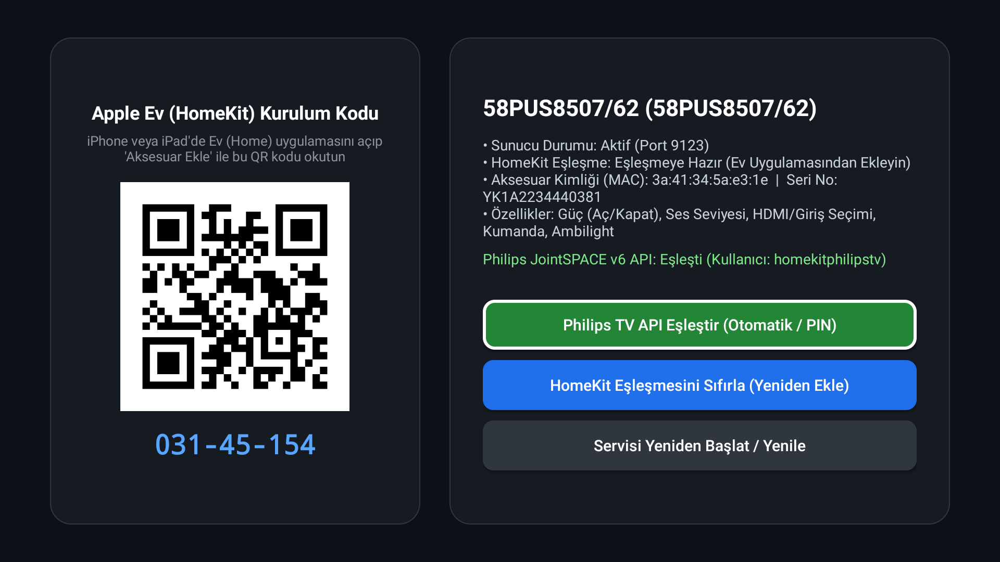

# AndroidTV-HomeKit

Connect your Android TV to the Apple Home app on your iPhone or iPad!  
*Android televizyonunuzu iPhone veya iPad'deki Apple Ev (Home) uygulamasına bağlayın!*

<p align="center">
  
</p>

> **Credits & Upstream Project / Kaynak & Teşekkür:**  
> This project is a modernized, bug-fixed, and extended fork of **[Samuel Thomas (samuelthomas2774/android-tv-homekit)](https://github.com/samuelthomas2774/android-tv-homekit)**. We are truly grateful to Samuel Thomas for establishing the foundational architecture.  
> *Bu proje, Samuel Thomas tarafından başlatılan orijinal [samuelthomas2774/android-tv-homekit](https://github.com/samuelthomas2774/android-tv-homekit) projesinin güncellenmiş ve genişletilmiş sürümüdür.*

---

## Navigation / İçindekiler
- [English Documentation](#-english-documentation)
  - [What Does This App Do?](#what-does-this-app-do)
  - [Key Features](#key-features)
  - [Compatibility & Hardware Disclaimer](#compatibility--hardware-disclaimer)
  - [Step-by-Step Installation Guide](#step-by-step-installation-guide)
  - [AI Prompt for Automated Setup](#ai-prompt-for-automated-setup)
  - [Issues & Bug Reporting](#issues--bug-reporting)
- [Türkçe Dokümantasyon](#-türkçe-dokümantasyon)
  - [Bu Uygulama Ne İşe Yarar?](#bu-uygulama-ne-işe-yarar)
  - [Özellikler](#özellikler)
  - [Cihaz Uyumluluk Bildirimi](#cihaz-uyumluluk-bildirimi)
  - [Adım Adım Kurulum Rehberi](#adım-adım-kurulum-rehberi)
  - [Yapay Zeka (AI) Kurulum Promptu](#yapay-zeka-ai-kurulum-promptu)
  - [Hata Bildirimi ve Destek](#hata-bildirimi-ve-destek)

---

# 🇬🇧 English Documentation

## What Does This App Do?
AndroidTV-HomeKit turns your Android TV into a native **Apple HomeKit Television**.

You do **not** need a Raspberry Pi, Mac, Homebridge, or Home Assistant server running. Simply install this APK directly on your TV, scan the QR code from your iPhone, and your TV is instantly integrated into your Apple smart home ecosystem.

## Key Features
1. **Apple Home App (iOS, iPadOS, macOS, watchOS):**
   - **Power (Standby):** Turn your TV on or off (Sleep / Wake).
   - **Input Switching:** Switch between HDMI ports, TV tuner, and installed streaming apps (Netflix, YouTube, Prime Video, etc.).
   - **Ambilight (Philips TVs):** Automatically detected and exposed as an independent Apple Home Lightbulb (Power, Brightness, Color Hue & Saturation).
2. **Apple TV Remote (iOS Control Center):**
   - Swipe down from the top-right corner of your iPhone to open the Control Center, tap the Remote icon, and select your TV.
   - Use the D-Pad, OK, Back, and Play/Pause buttons to navigate TV menus without needing your physical remote.
   - Adjust TV volume using your iPhone's **physical side volume buttons**.

## Compatibility & Hardware Disclaimer
- **Verified & Tested Hardware:**  
  **Philips 58PUS8507/12 (58PUS8507/62, Android TV 11)** — Apple Home pairing, iPhone Remote widget, volume rockers, HDMI input switching, and Ambilight color/brightness control are confirmed fully working.
- **General Compatibility:**  
  Designed for all devices running Android TV 9 through 14 (Sony, TCL, Xiaomi Mi Box / TV Stick, Chromecast with Google TV, Onn, Philips, etc.).  
  > [!IMPORTANT]
  > Because different manufacturers apply custom OEM Android modifications and power management rules, **100% flawless compatibility cannot be guaranteed across every single television model**. Please test on your device and share your experience in the Issues section!

---

## Step-by-Step Installation Guide

### Step 1: Enable Developer Options & USB Debugging on Your TV
1. On your TV, navigate to **Settings** -> **Device Preferences** -> **About**.
2. Scroll down to **Android TV Build** and press the **OK** button on your remote **7 times** continuously until a toast message says *"You are now a developer!"*.
3. Go back one menu level and enter **Developer Options**.
4. Turn on **USB Debugging** (and Wireless Debugging if available).
5. Check your TV's local IP address: Go to **Settings** -> **Network & Internet** -> click on your active Wi-Fi (e.g., `192.168.1.50`).

### Step 2: Install the App on Your TV

#### Option A: Using the Pre-built APK (Quickest)
1. Download `AndroidTvHomeKit.apk` from the [Releases](https://github.com/ichZara/AndroidTV-HomeKit/releases) page.
2. Open a terminal or PowerShell on your computer (make sure ADB is installed) and run:
   ```bash
   # Connect to your TV over Wi-Fi:
   adb connect <TV_IP_ADDRESS>:5555
   # (Check your TV screen: a dialog 'Allow USB debugging?' will appear. Check 'Always allow' and press OK)

   # Install the APK:
   adb install -r AndroidTvHomeKit.apk

   # Launch the setup dashboard on your TV:
   adb shell am start -n uk.org.fancy.AndroidTvHomeKit/.MainActivity
   ```

#### Option B: Building from Source Code
If you want to compile the project yourself:
```bash
git clone https://github.com/ichZara/AndroidTV-HomeKit.git
cd AndroidTV-HomeKit
./gradlew assembleDebug
adb connect <TV_IP_ADDRESS>:5555
adb install -r app/build/outputs/apk/debug/app-debug.apk
adb shell am start -n uk.org.fancy.AndroidTvHomeKit/.MainActivity
```

### Step 3: Pair with Apple Home on iPhone / iPad
1. Open the **Home** app on your iPhone or iPad.
2. Tap the **+** button in the top-right corner and select **Add Accessory**.
3. Point your camera at the QR code displayed on your TV screen (or enter the 8-digit setup PIN shown beneath it, e.g. `031-45-154`).
4. Follow the on-screen prompts to name your TV and assign it to a room. You are all set!

---

## AI Prompt for Automated Setup
If you prefer an AI assistant (ChatGPT, Claude, Gemini, or a terminal AI agent) to handle the setup, copy and paste this prompt:

````markdown
I want to install the AndroidTV-HomeKit bridge onto my Android TV using this GitHub repository:
Repo: https://github.com/ichZara/AndroidTV-HomeKit
My TV's local IP address is: [REPLACE_WITH_YOUR_TV_IP, e.g. 192.168.1.50]

Please guide me or execute the following steps:
1. Either download the latest AndroidTvHomeKit.apk from the releases or clone the repo and build it with Gradle.
2. Connect to my TV via ADB over Wi-Fi.
3. Install the APK onto the TV and launch the setup dashboard (uk.org.fancy.AndroidTvHomeKit/.MainActivity).
4. Provide troubleshooting instructions in case of connection or permission issues.
````

---

## Issues & Bug Reporting
If you encounter a bug, crash, or key mapping mismatch on your TV model, please open a ticket on **[GitHub Issues](https://github.com/ichZara/AndroidTV-HomeKit/issues)**.  
When reporting, please include your **TV brand, exact model code, and Android OS version**.

---

## Other Repositories
Explore more open-source Android TV and smart home projects on my **[GitHub Profile (@ichZara)](https://github.com/ichZara)**.

---
---

# 🇹🇷 Türkçe Dokümantasyon

## Bu Uygulama Ne İşe Yarar?
AndroidTV-HomeKit, Android televizyonunuzun üzerinde doğrudan çalışarak onu yerel bir **Apple HomeKit Televizyonu** haline getirir.

Çalışması için evinizde sürekli açık kalması gereken harici bir Raspberry Pi, Mac, Homebridge veya Home Assistant sunucusuna **ihtiyaç duymaz**. APK dosyasını televizyonunuza kurup ekranda çıkan QR kodu iPhone'unuzla okutarak televizyonunuzu Apple akıllı ev sisteminize dahil edebilirsiniz.

## Özellikler
1. **Apple Ev Uygulaması (iOS, iPadOS, macOS, watchOS):**
   - **Açma / Kapatma (Standby):** TV'yi tek dokunuşla açıp kapatma (uykuya alma/uyandırma).
   - **Giriş ve Uygulama Seçimi:** HDMI girişleri, TV kanalları ve Netflix, YouTube, Prime Video gibi yüklü uygulamalar arasında geçiş yapma.
   - **Ambilight (Philips TV'ler):** Apple Ev içinde ayrı bir akıllı lamba olarak görünür; açıp kapatabilir, parlaklığını kısabilir ve renklerini değiştirebilirsiniz.
2. **iOS Denetim Merkezi Kumandası (Apple TV Remote):**
   - iPhone ekranınızı sağ üstten aşağı kaydırıp **Kumanda** simgesine dokunun ve televizyonunuzu seçin.
   - Yön tuşları, OK, Geri ve Oynat/Duraklat tuşlarıyla TV arayüzünde gezinin.
   - Telefonunuzun **yanındaki fiziksel ses açma/kısma tuşlarıyla** televizyonun sesini doğrudan ayarlayın.

## Cihaz Uyumluluk Bildirimi
- **Bizzat Test Edilip Doğrulanan Model:**  
  **Philips 58PUS8507/12 (58PUS8507/62, Android TV 11)** — Apple Ev eşleşmesi, iPhone kumanda widget'ı, ses tuşları, HDMI geçişleri ve Ambilight renk/parlaklık kontrolleri test edilmiş ve kusursuz çalıştığı doğrulanmıştır.
- **Diğer Cihazlar:**  
  Android TV 9, 10, 11, 12, 13 ve 14 kullanan tüm televizyon ve TV kutuları (Sony, TCL, Xiaomi Mi Box, Chromecast with Google TV vb.) için tasarlanmıştır.  
  > [!IMPORTANT]
  > Farklı televizyon üreticilerinin uyguladığı özel sistem kısıtlamaları ve güç yönetimi kuralları nedeniyle **her marka ve modelde %100 sorunsuz çalışma garantisi verilemez**. Lütfen kendi cihazınızda test edip deneyimlerinizi Issues bölümünde paylaşın!

---

## Adım Adım Kurulum Rehberi

### 1. Televizyonda ADB Hata Ayıklamayı Açma
1. TV'de **Ayarlar (Settings)** -> **Cihaz Tercihleri** -> **Hakkında** bölümüne gidin.
2. **Android TV Derlemesi (Build)** seçeneğine kumandanın **OK** tuşuyla **7 kez** arka arkaya basın (*"Artık bir geliştiricisiniz"* bildirimi çıkana kadar).
3. Geri gelip **Geliştirici Seçenekleri** menüsüne girin ve **USB Hata Ayıklama (USB Debugging)** seçeneğini açın.
4. **Ayarlar** -> **Ağ ve İnternet** kısmından TV'nizin yerel IP adresini not edin (örnek: `192.168.1.50`).

### 2. Uygulamayı Televizyona Yükleme

#### Yöntem A: Hazır APK Dosyasını İndirerek (En Hızlısı)
1. [Releases](https://github.com/ichZara/AndroidTV-HomeKit/releases) sayfasından `AndroidTvHomeKit.apk` dosyasını indirin.
2. Bilgisayarınızda terminal veya PowerShell açıp (ADB yüklü olduğundan emin olun) şu komutları çalıştırın:
   ```bash
   # Televizyona Wi-Fi üzerinden bağlanın:
   adb connect <TELEVIZYON_IP_ADRESI>:5555
   # (TV ekranına 'Bu bilgisayara her zaman izin verilsin mi?' kutusu gelir; kumandayla 'Her zaman izin ver'i seçip OK deyin)

   # APK'yı televizyona kurun:
   adb install -r AndroidTvHomeKit.apk

   # TV ekranındaki eşleştirme arayüzünü açın:
   adb shell am start -n uk.org.fancy.AndroidTvHomeKit/.MainActivity
   ```

#### Yöntem B: Kaynak Koddan Derleyerek
Projeyi kendiniz derlemek isterseniz:
```bash
git clone https://github.com/ichZara/AndroidTV-HomeKit.git
cd AndroidTV-HomeKit
./gradlew assembleDebug
adb connect <TELEVIZYON_IP_ADRESI>:5555
adb install -r app/build/outputs/apk/debug/app-debug.apk
adb shell am start -n uk.org.fancy.AndroidTvHomeKit/.MainActivity
```

### 3. iPhone / iPad'den Ev Uygulamasına Ekleme
1. iPhone'unuzda **Ev (Home)** uygulamasını açın.
2. Sağ üstteki **+** simgesine dokunup **Aksesuar Ekle** seçeneğini seçin.
3. Televizyon ekranında açılan QR kodu kameranızla okutun (veya ekrandaki `031-45-154` PIN kodunu girin).
4. TV adını ve bulunduğu odayı seçin. Kurulum tamamlandı!

---

## Yapay Zeka (AI) Kurulum Promptu
ADB komutlarıyla uğraşmak istemiyorsanız, aşağıdaki promptu kullandığınız yapay zeka asistanına (ChatGPT, Claude, Gemini veya terminal AI aracınıza) vererek kurulumu baştan sona ona yaptırabilirsiniz:

````markdown
Aşağıdaki GitHub deposunu kullanarak Android TV'me Apple HomeKit köprüsünü kurmak istiyorum:
Repo: https://github.com/ichZara/AndroidTV-HomeKit
Televizyonumun yerel IP adresi: [BURAYA_TELEVIZYONUN_IP_ADRESINI_YAZIN, örn: 192.168.1.50]

Lütfen şu adımları benim için sırasıyla açıkla veya terminal komutlarıyla çalıştır:
1. Depodaki son sürüm APK'yı (AndroidTvHomeKit.apk) indir veya depoyu klonlayıp Gradle ile derle.
2. Bilgisayarımdan ADB ile yukarıdaki televizyon IP adresine bağlan.
3. APK'yı televizyona yükle ve kurulum arayüzünü (uk.org.fancy.AndroidTvHomeKit/.MainActivity) televizyon ekranında başlat.
4. Hata alırsam (örneğin cihaz bulunamadı veya bağlantı reddedildi) nasıl düzelteceğimi belirt.
````

---

## Hata Bildirimi ve Destek
Bir hata, çökme veya kumanda tuş uyumsuzluğu fark ederseniz lütfen **[GitHub Issues](https://github.com/ichZara/AndroidTV-HomeKit/issues)** sayfasından bildirin!  
Bildirirken televizyonunuzun **markasını, tam model kodunu ve Android sürümünü** belirtmeniz sorunun hızla giderilmesini sağlayacaktır.

---

## Lisans / License
MIT License. Based on original project by `samuelthomas2774/android-tv-homekit`.

---

## Diğer Projeler
Geliştirdiğim diğer açık kaynaklı Android TV ve akıllı ev projelerine göz atmak için **[GitHub Profilimi (@ichZara)](https://github.com/ichZara)** ziyaret edebilirsiniz.
